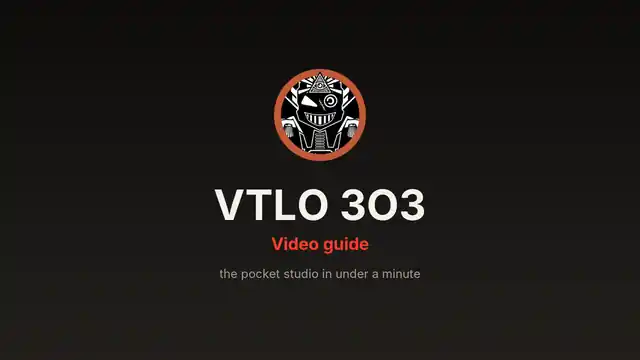

<p align="center">
  
</p>

<p align="center">
  <a href="assets/guide.mp4" title="Video guide, 1 min 46 s, with sound"></a>
</p>

# VTLO 303

A TB-303 bass line, a 606/808/909 drum machine and a sampler: in the **browser**,
as an **Android app**, and as a **Windows / Linux desktop app**. Download the
ready-made builds from the [latest release](../../releases/latest) or from
[`downloads/`](downloads/).

## Android app (`android/`)


**VTLO 3O3** is a standalone, fully offline studio for Android: two TB-303 bass
lines, two 606/808/909 drum machines, a sampler and a master effects rack on six
screens you swipe between (or pick with the tabs at the top: BASS 1, BASS 2,
DRUMS 1, DRUMS 2, SAMPLER, FX). Native Kotlin, no WebView, no
third-party libraries; it targets **Android 17 (API 37)** and runs on
Android 8.0 (API 26) and newer. Permissions: foreground service and
notifications (background playback) and the microphone, which is only asked
for the first time you press REC.

**Studio**
- One transport: RUN on any screen starts all five instruments on the same
  sample, and they share tempo and swing, so they stay locked. The B1, B2,
  D1, D2 and SMP ON/OFF buttons take a part out of the mix without stopping it.
- BASS 2 and DRUMS 2 are full, independent copies of the first bass line and
  drum machine, with their own patterns, sounds, kits and saved state. They
  start with empty patterns, so the mix is unchanged until you program them.
- **FX page**: six master effects in series on the whole mix, each with an ON
  switch and four knobs, saved with the rest of the state (see below).
- **Pad deck** (optional, per page): the slim `▲ PADS` handle under BASS 1/2,
  DRUMS 1/2 and SAMPLER opens a 4 x 4 grid of rubber pads styled after a hardware
  clip controller (cream body, red inline wordmark, a "VTLO Mod. V2.0" nameplate).
  Play the instrument by hand (drums and sampler: pads 1-8 are the tracks, 9-16 the
  same with accent; bass: chromatic notes, OCT -/+ to move the range). Arm **REC**
  and tap a rhythm in: the first tap starts the transport and fills a **loop of
  8 or 16 bars** locked to the tempo, overdubbing on every lap. QUANT snaps taps to
  16ths, LOOP mutes or plays the recorded loop, UNDO removes the last pass, CLEAR
  empties it, CLICK adds a metronome. Each instrument has its own loop, saved with
  the rest of the state; hidden or shown per page. Playback is sample-accurate.
- Orientation option in the top bar: LANDSCAPE (default), PORTRAIT or AUTO
  ROTATE, remembered between launches. Landscape fits every control of a
  screen on one display, scaled to the window; portrait scrolls. Large screens
  (where Android 16+ ignores orientation requests) follow the window's shape.
- Background playback in a `mediaPlayback` foreground service with a
  MediaSession: stop from the notification, lock screen, headset or Bluetooth
  buttons, or by swiping the app away. Audio focus is respected and playback
  stops when headphones are unplugged.
- WAV export (24-bit, 48 kHz) of either part through the system file picker.
- Edge-to-edge, predictive back, resizable windows; TalkBack can operate every
  control.

**Bass line**
- TB-303 voice modelled on Open303's measurements: PolyBLEP saw/square, 44 Hz
  pre-HP, 4-pole diode-ladder model with 150 Hz feedback HP and soft-clipping
  feedback, post 24 Hz HP / 14 Hz all-pass / 7.5 Hz notch, calibrated
  cutoff/env-mod curves, 200 ms accent decay, 60 ms RC slide.
- Accent "sweep" circuit: consecutive accents stack, resonance sets the leak.
- Oscillator and filter run 4× oversampled with a 12th-order anti-aliasing
  decimator (aliasing below −110 dB in tests).
- Slide uses hardware semantics (slide on a step glides into the next one).
- 16 patterns (2 banks × 8) with per-pattern length, presets, random,
  copy/paste, undo; pattern changes are queued to the end of the loop.

**Drum machine**
- Three bundled kits (606, 808, 909), eight tracks each: kick, snare, tom,
  clap (606: high tom), rim, closed hat, open hat, cymbal (909: ride).
  Switch the whole machine with the kit buttons, or mix kits per track with
  the TRACK panel's KIT knob.
- Samples are converted once to the device's native rate with a
  Kaiser-windowed sinc (≈100 dB SNR) and cached; retuned tracks use 4-point
  Hermite interpolation.
- 8×16 step grid with per-step accent (long-press), per-track level, tune
  (±12 semitones), decay, pan and mute, closed-hat choke of the open hat, and
  click-free retriggering. 16 patterns, presets, random, copy/paste, undo.

**Sampler**
- Eight pads. Record from the microphone (unprocessed source where the device
  offers it, up to 30 s, live waveform and level meter; silence is trimmed and
  the take normalized), or load any audio file the device can decode (WAV, MP3,
  AAC/M4A, OGG, FLAC…). On first run the pads hold sounds from the bundled kits.
- Per-pad effects: level, tune (±24 semitones), start/end trim (knobs or drag
  the markers on the waveform), attack, decay, reverse, one-knob low-pass /
  high-pass resonant filter, bit-crusher (16 → 3 bits with sample-rate
  reduction), drive, pan and an effects send into the master delay and reverb.
  NORMAL normalizes a pad, ERASE clears it, MUTE silences it in the sequence.
- 16-step sequencer per pad with accents, 16 patterns; pad audio is stored in
  app storage as 32-bit float WAV, settings and patterns in preferences.
- Recording stops whenever the app leaves the foreground.

**Shared**
- Sequencers are clocked by the audio sample counter (sample-accurate).
- Overdrive, tempo-synced ping-pong delay, FDN reverb and soft limiter per
  part, plus a limiter on the mix.
- Low-latency float `AudioTrack` at the device's native rate, real-time
  thread, buffer auto-grows on underruns.

**Modules**: `engine` (plain Kotlin/JVM: all three sound engines, sequencers,
effects, WAV I/O, resampler and the studio mixer, shared with the desktop
app), `core` (Android audio output, transport, service, widgets, pager),
`drums` (kits, drum screen), `sampler` (recorder, file decoder, sampler
screen), `app` (bass line screen, the activity), `desktop` (Windows app).

**Build**
```bash
cd android
./gradlew testDebugUnitTest assembleRelease
# -> app/build/outputs/apk/release/app-release.apk
```
Requires JDK 17+ and the Android SDK with `platforms;android-37.0` and
`build-tools;37.0.0`. Release builds are minified and signed with
`keystore.properties` (`storeFile`, `storePassword`, `keyAlias`, `keyPassword`)
if present, otherwise with the local debug key. CI builds the APK on every push
(see the "Android APK" workflow artifact `vtlo-3o3-apk`).

### Master effects (FX page)

Six effects, in this chain order, act on the whole mix just before the limiter.
All are in `android/engine` (`com.vtlo.fx`), pure Kotlin shared by Android and desktop,
and each switches in and out with a short crossfade.

| Effect | What it does | Knobs |
|---|---|---|
| **Beat Repeat** | Captures the last slice of the mix when switched on and loops it, locked to the studio tempo; the live signal returns on release | GRID (1/2 to 1/32), GATE, DECAY, MIX |
| **Warble** *(original)* | Worn tape: slow wow and fast flutter bend the pitch, a random drift keeps it from repeating, HEAT adds saturation and rolls off the highs | WOW, FLUTTER, HEAT, MIX |
| **Vowel** *(original)* | A talking filter: three resonant band-passes on the formants of A, E, I, O, U, swept by an LFO (opposite phase left and right) | VOWEL, RATE, DEPTH, MIX |
| **Flanger** | Swept comb filter with feedback, quadrature LFO per channel | RATE, DEPTH, FEEDBACK, MIX |
| **Chorus** | Three detuned voices per channel with Hermite-interpolated delays | RATE, DEPTH, SPREAD, MIX |
| **Ghost** *(original)* | Reverse echoes: overlapping windowed grains read the signal backwards, fed back so repeats reverse again | TIME, FEEDBACK, TONE, MIX |

**Tempo sync.** Each effect except Beat Repeat (always locked) has a SYNC switch. With
it on, the speed or time knob (RATE, or TIME for Ghost) becomes a note-length selector
(8 bars down to 1/16 for the sweeps; 1/16 to 1/2 for Ghost's echo) and the LFOs lock
to the transport position, so every sweep starts on a bar line. The free value and the
note length are remembered separately, so switching loses nothing.

The effects apply live to the master bus; WAV exports render each instrument on its own, without them.

### Emblem

Both the Android studio and the Windows app show the two-faced VTLO coin
(robot on one side, winking smiley on the other) flipping continuously in the
upper-right corner of every screen. It is purely decorative: it takes no
taps, clicks or focus, is hidden from screen readers, and on Android it holds
still when system animations are turned off.

## Downloads (`downloads/`)

Ready-to-install builds, committed to the repository (checksums in `SHA256SUMS`):

| Platform | File |
|---|---|
| Android 8.0+ (APK) | `VTLO-3O3-android.apk` |
| Windows 10/11 x64 installer | `VTLO-3O3-Setup-windows-x64.exe` |
| Linux, Debian/Ubuntu (`sudo apt install ./vtlo-3o3_1.2.0_amd64.deb`) | `vtlo-3o3_1.2.0_amd64.deb` |
| Linux, any distribution (unpack and run) | `VTLO-3O3-linux-x64.tar.gz` |
| Browser version for Windows and Linux (launchers included) | `VTLO-303-web-windows-linux.zip` |

The desktop builds include their own Java runtime. The APK is signed with a
debug key, so Android may ask you to allow installs from this source.
Rebuild them with `android/desktop/packaging/build-portable.sh` (Windows),
`build-linux.sh`, `tools/build-web-zip.sh`, and `./gradlew assembleRelease`.

## Windows app (`android/desktop`)

The same studio for the computer: the five instruments and the FX page on six screens (tabs
at the top), running the very same `engine` code as the Android app, so they
sound identical. Swing UI drawn to scale like the Android landscape layout
(resize the window freely), Java Sound for output and the microphone, no
third-party libraries.

- **Download**: ready-made installers are in [`downloads/`](downloads/) (see
  below). The "Android APK and Windows app" workflow also publishes
  `vtlo-3o3-windows`, a folder with `VTLO 3O3.exe` and its own Java runtime
  (built with `jpackage`). Unzip anywhere and run; nothing to install.
- **Keys**: Space run/stop, Tab next screen (F1–F6 jump), Esc panic; bass line
  keyboard on Z S X D C V G B H N J M , ; sampler pads on Q W E R / A S D F.
  With a pad deck open, `1 2 3 4` / `Q W E R` / `A S D F` / `Z X C V` play its pads (top row
  to bottom row, several keys at once) instead of the page's own keys.
  Right-click a step for gate (bass) or accent (drums, sampler); knobs take
  drag, mouse wheel, and double-click to reset.
- Sampler loads WAV, AIFF and AU and records from the default microphone.
  State and pad audio are saved in `%APPDATA%\VTLO 3O3` (`~/.vtlo-3o3`
  elsewhere).

**Build**
```bash
cd android
./gradlew -PdesktopOnly :desktop:run          # run it (any OS with JDK 17+)
./gradlew -PdesktopOnly :desktop:installDist  # jars in desktop/build/install
desktop/packaging/build-portable.sh           # portable Windows zip from Linux (needs mingw-w64)
```
`-PdesktopOnly` skips the Android modules, so no Android SDK is needed.

## Credits and origins

Built from scratch by FreeTekno Lysergic Inspired Tribe Methodology @√T|_o{PACTK}